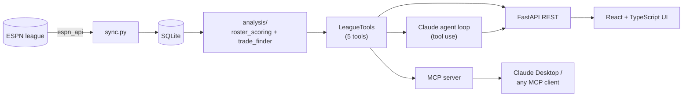

# Fantasy Trade Agent

An AI agent that connects to an ESPN fantasy football league, analyzes every team's roster, and
suggests trades that help **both** sides, explaining why the other manager would accept.

<!-- TODO: add demo GIF here (docs/demo.gif): pick team -> suggested trades -> ask agent -> tool steps -->

## How it works

The work is split between deterministic code and the LLM:

- **Code does the search.** Every roster is scored by its best legal lineup. The trade finder
  tries every 1-for-1 swap with every other team and keeps only those where *both* lineups
  improve. This is cheap, reproducible and unit-tested.
- **The agent does the judgment.** Claude gets a short list of candidates and *tools* to check
  players, needs and trade math. It ranks the options, explains both sides, flags injury risk and
  drafts a pitch message. Every tool call is logged and shown in the UI.



The five tools (`get_team_roster`, `get_player_details`, `get_team_needs`,
`find_trade_candidates`, `evaluate_trade`) are defined once and shared by the agent, the REST API
and the MCP server.

## Tech stack

Python 3.11+, FastAPI, SQLAlchemy + SQLite, `espn_api`, Anthropic Python SDK (tool use),
MCP Python SDK, React + TypeScript + Vite, pytest, ruff, Docker, GitHub Actions.

## Quick start

```bash
cp .env.example .env                 # fill in league ID, ESPN cookies, Anthropic key
cd backend
pip install -e ".[dev,mcp]"
python -m app.sync                   # ESPN -> SQLite, prints every roster
uvicorn app.main:app --reload        # API on http://localhost:8000
```
```bash
cd frontend
npm install && npm run dev           # UI on http://localhost:5173 (proxies /api to :8000)
```

Command-line versions of everything:

```bash
python -m app.analysis.trade_finder --team "My Team"
python -m app.agent.agent --team "My Team" "find me a trade for a WR"
python mcp_server/server.py          # MCP server over stdio
```

`.env` holds `ESPN_LEAGUE_ID`, `ESPN_YEAR`, `ESPN_S2`, `ESPN_SWID`, `ANTHROPIC_API_KEY`,
`ANTHROPIC_MODEL`. The ESPN cookies work like a login: never commit `.env` (it is git-ignored).

## Docker

```bash
docker compose up --build            # UI + API on http://localhost:8000
docker compose run --rm app python -m app.sync    # load your league into the volume
```
The image is built in two stages (Node builds the UI, Python serves it), so one container runs
everything. Secrets come from `.env` at runtime and are never baked into the image.

## MCP server

Exposes the same five tools to any MCP client (Claude Desktop, Claude Code, ...). Add to the
client's config, adjusting paths:

```json
{
  "mcpServers": {
    "fantasy-trade-agent": {
      "command": "C:/path/to/repo/backend/.venv/Scripts/python.exe",
      "args": ["C:/path/to/repo/mcp_server/server.py"]
    }
  }
}
```
Run `python -m app.sync` first. The server re-reads the database on every call.

## Tests and CI

```bash
cd backend && ruff check . ../mcp_server && pytest
cd frontend && npm run build         # type-check + bundle
```
Tests never call ESPN or Anthropic: league data comes from `backend/tests/fixtures/`, and the
agent loop is tested against a scripted fake client. GitHub Actions (`.github/workflows/ci.yml`)
runs lint, tests, the frontend build and a Docker build on every push and PR.

## Deployment notes

The app has **no authentication**, and `POST /api/agent` spends your Anthropic credits. Do not
expose it publicly with a real API key. Safe options: run it locally, put it behind your host's
access control / VPN, or deploy a demo with the agent disabled (leave `ANTHROPIC_API_KEY` unset;
the endpoint then returns 503). Any host that runs a Docker image works (Render, Fly.io, Railway):
mount a persistent volume at `/data` and set `DATABASE_URL=sqlite:////data/fantasy.db`.

## Design decisions

- **Snapshot dict as the boundary.** `espn_client` converts the live league to a plain dict; the
  rest of the app (and every test) uses that, so nothing depends on ESPN being reachable.
- **Brute-force trade search.** Rosters are about 15 players, so checking every swap is instant
  and finds trades hand-written "surplus meets need" rules would miss.
- **Rank by the smaller gain.** Favors deals the other manager would accept over lopsided ones.
- **Manual tool-use loop** instead of an SDK helper: about 30 lines, easy to log and explain,
  with a step cap so a confused model can't loop forever.

## Limitations

- Trades are 1-for-1 in the search (the evaluator accepts any N-for-M); no waiver-wire or
  schedule awareness.
- The agent only sees projections, season points and injury status, not news or game logs.
  Retrieval over injury/depth-chart news is the planned next step.
- Projections are whatever ESPN reports; the lineup rules in `roster_scoring.py` are constants to
  match your league's settings.
